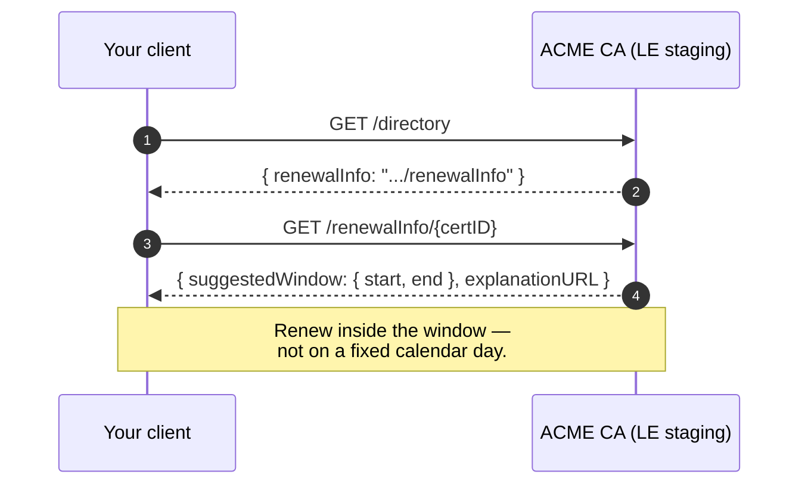

# acme-ari-demo

A minimal, educational ACME client that teaches **Renewal Information (ARI)** — the small piece of the ACME protocol that tells you *when* to renew a cert, not just "30 days before NotAfter".

> **Teaching tool. Not a CLM.** Defaults to Let's Encrypt **STAGING**. Built by [TigerTrust](https://tigertrust.io). Apache-2.0.

## Why ARI matters for 47-day lifetimes

The "renew at 30 days" rule was born when certs lived 398 days. With **47-day** lifetimes coming to the Web PKI (CA/B Forum SR-241), that rule overshoots — if you renew at 30 days every time, you're re-issuing at day 17 of a 47-day cert. Not awful, but wasteful and fragile.

ARI (draft-ietf-acme-ari / RFC 9773) flips the question. The CA tells your client the *suggested renewal window* for a specific cert, considering operational realities the client can't see (CA load, pending revocation, known-compromise events). You renew inside the window — the CA stays in control, you stop guessing.



## Install

```sh
go install github.com/tigertrust/acme-ari-demo/cmd/ari-demo@latest
```

## Quick start

### Fetch ARI for an existing certificate

```sh
ari-demo ari-check --cert /etc/letsencrypt/live/example.com/cert.pem
```

```
Cert thumbprint (SHA-256): 83:DE:03:...
NotAfter:                  2026-12-24T12:00:00Z
Suggested window start:    2026-12-10T00:00:00Z
Suggested window end:      2026-12-14T00:00:00Z
Explanation:               https://letsencrypt.org/docs/renewal-info/

Renewal window opens in 173h20m0s (at 2026-12-10T00:00:00Z UTC).

With 47-day certs, renew in the ARI window — not on a fixed calendar day.
```

### JSON for automation

```sh
ari-demo ari-check --cert cert.pem --json | jq '.inWindow, .renewalInfo.suggestedWindow'
```

### Issue a cert against LE staging with manual DNS-01

```sh
ari-demo issue \
  --domain demo.example.com \
  --email you@example.com \
  --datadir ./_acme
```

The tool will stop and print:

```
===== MANUAL DNS-01 =====
Publish this DNS TXT record and wait for propagation:

    _acme-challenge.demo.example.com.  TXT  "abcDEF123..."

Press Enter when the record is in place...
```

Publish the record (via your DNS UI or `cli53`/`route53` CLI), wait a minute for propagation, then press Enter. On success you get `_acme/cert.pem` and `_acme/cert.key`, and the ARI window is printed.

### Point at a different directory (still a staging environment!)

```sh
ari-demo ari-check \
  --cert cert.pem \
  --directory-url https://some-staging-ca.example/acme/directory
```

## How the ARI cert identifier is built

Per draft-ietf-acme-ari §4.1:

```
certID = base64url(AuthorityKeyIdentifier) "." base64url(serialNumber)
```

Both halves use **unpadded** URL-safe base64. The leaf must carry an
`AuthorityKeyIdentifier` extension — modern public CAs do; some ancient
self-signed roots don't.

## File layout under `--datadir`

| File | Mode | Purpose |
|------|-----:|---------|
| `account.key` | `0600` | ACME account key (ECDSA P-256) |
| `cert.pem` | `0644` | Issued leaf + any intermediates returned by the CA |
| `cert.key` | `0600` | Private key for the leaf |

`_acme/` is in `.gitignore`. **Do not commit it.**

## Subcommand reference

### `ari-demo issue`

| Flag | Default | Meaning |
|------|---------|---------|
| `--directory-url` | LE staging | ACME directory to speak to |
| `--domain` | — | Domain to issue for |
| `--email` | — | ACME account contact |
| `--datadir` | `./_acme` | Where to write keys and the issued cert |
| `--timeout` | `10m` | Overall ceiling on the issuance flow |
| `--json` | `false` | Emit the final ARI report as JSON |

### `ari-demo ari-check`

| Flag | Default | Meaning |
|------|---------|---------|
| `--cert` | — | Path to a leaf PEM |
| `--directory-url` | LE staging | Directory to query for the ARI endpoint |
| `--renewal-info-url` | — | Skip directory discovery; use this ARI base URL directly |
| `--json` | `false` | Emit JSON |

## Safety

- The LE **production** directory URL is detected and prints a 3-second
  warning; you can still proceed, but the tool actively discourages it.
- If you do run `issue` against production, pair it with a CAA record that
  pins the CA (see [`caa-lint`](https://github.com/tigertrust/caa-lint)) and
  with an expiry monitor (see [`cert-expiry-action`](https://github.com/tigertrust/cert-expiry-action)).

## Related

- [`caa-lint`](https://github.com/tigertrust/caa-lint)
- [`cert-expiry-action`](https://github.com/tigertrust/cert-expiry-action)
- [`47-day-readiness-score`](https://github.com/tigertrust/47-day-readiness-score)
- Blog: *Why "renew at 30 days" breaks at 47-day lifetimes — ACME ARI demo*

## License

Apache-2.0. See [LICENSE](./LICENSE) and [SECURITY.md](./SECURITY.md).
